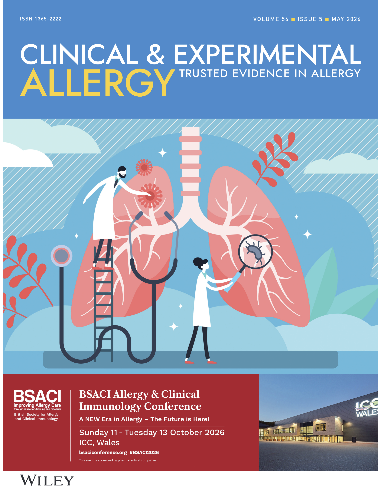
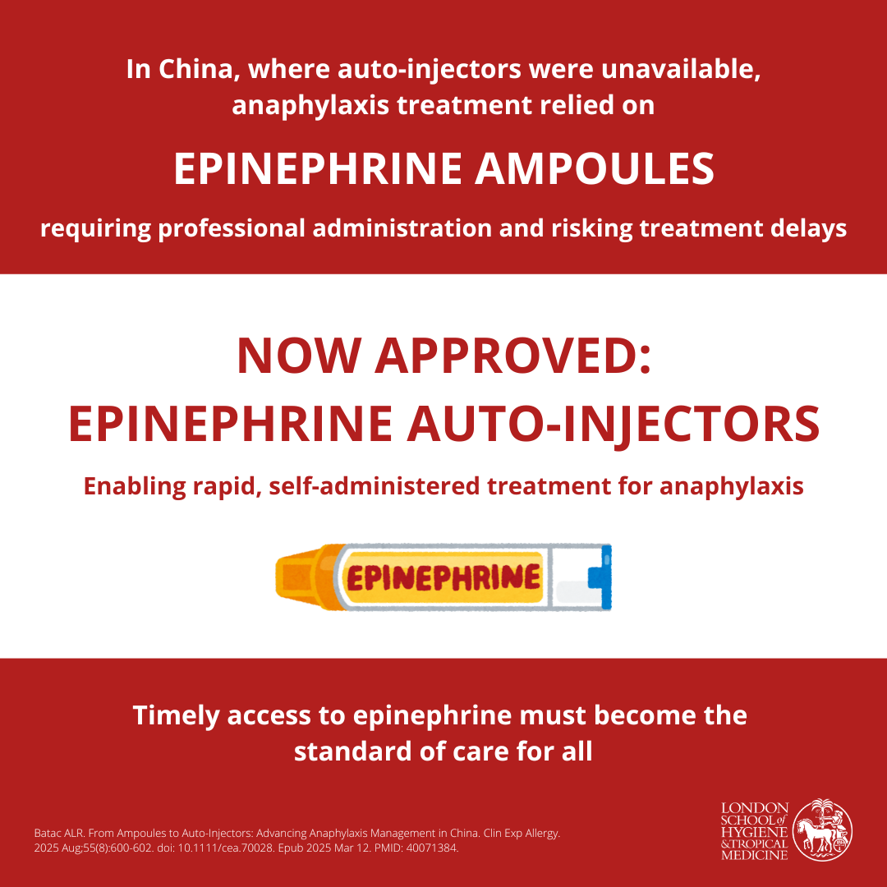

# ANAPHYLAXIS

$~$

<strong class="ana-emphasis">Anaphylaxis</strong> is a severe allergic reaction that can develop rapidly and become life-threatening. It may cause breathing difficulties or a sudden drop in blood pressure. <strong class="ana-emphasis">Intramuscular adrenaline</strong> (also known as epinephrine), administered by injection into a muscle, is the <a class="blog-source-link" href="https://doi.org/10.1016/j.waojou.2020.100472"><span class="blog-link-text"><strong class="ana-emphasis">recommended first-line treatment</strong></span><span class="blog-link-arrow" aria-hidden="true">&nbsp;↗</span></a> for anaphylaxis. Despite this established clinical recommendation, <strong class="ana-emphasis">adrenaline remains underused in emergency care</strong>.

My research examines the gap between recommended anaphylaxis treatment and the care people receive in practice. I am particularly interested in how differences between health systems affect access to emergency treatment and preparedness for anaphylaxis.

## Global Variation in Anaphylaxis Treatment

Studies across different healthcare settings have documented the <strong class="ana-emphasis">underuse of adrenaline</strong> during anaphylaxis, with <strong class="ana-emphasis">antihistamines</strong> or <strong class="ana-emphasis">corticosteroids</strong> sometimes administered in its place. Antihistamines can relieve certain symptoms of allergic reactions, such as itching and hives, but <a class="blog-source-link" href="https://doi.org/10.1016/j.resuscitation.2021.04.010"><span class="blog-link-text">neither medication can substitute for adrenaline in the emergency treatment of anaphylaxis</span><span class="blog-link-arrow" aria-hidden="true">&nbsp;↗</span></a>.

Differences in treatment practices may reflect how healthcare professionals recognise and manage anaphylaxis, as well as the resources available within their healthcare settings. Understanding whether recommended treatments are accessible and appropriately administered is important when examining variation in emergency care.

### Ongoing Research

I am leading an international scoping review examining how anaphylaxis is treated across different healthcare systems. The review maps existing evidence on emergency treatment and examines how reported practices compare with clinical recommendations.

Key areas of investigation include:

- **Treatment practices:** Examining international differences in the use of adrenaline and other medications during anaphylaxis.
- **Access to treatment:** Investigating reported differences in the availability and affordability of adrenaline.
- **Guideline adherence:** Assessing how reported treatment practices align with clinical recommendations.
- **Barriers to appropriate care:** Examining factors that may prevent or delay the administration of adrenaline.

The review considers the circumstances in which treatment practices have been documented, recognising that differences between studies may reflect how treatment is recorded as well as genuine variation in clinical practice.

## Access to Adrenaline and Prehospital Anaphylaxis Care

<strong class="ana-emphasis">Adrenaline auto-injectors (AAIs)</strong> allow people at risk of anaphylaxis or their caregivers to administer adrenaline before reaching hospital. Early administration is an important part of emergency treatment, but patients may require <a class="blog-source-link" href="https://doi.org/10.1016/j.waojou.2020.100472"><span class="blog-link-text">additional doses of adrenaline</span><span class="blog-link-arrow" aria-hidden="true">&nbsp;↗</span></a> if symptoms persist or recur. Access to subsequent medical assessment and emergency care therefore remains important even when prehospital treatment is available.

AAIs remain unavailable or difficult to obtain in many parts of the world. Where adrenaline is predominantly supplied in ampoules, small sealed containers from which the medication must be drawn into a syringe, patients may depend on trained healthcare professionals to administer their first dose. This can delay treatment when emergency medical assistance is not immediately available.

<a class="blog-source-link" href="https://doi.org/10.1016/j.waojou.2023.100821"><span class="blog-link-text">International disparities in AAI availability</span><span class="blog-link-arrow" aria-hidden="true">&nbsp;↗</span></a> mean that opportunities for prehospital treatment differ considerably between countries. Even where these devices are available, their cost can limit access for people at risk of anaphylaxis.

### Anaphylaxis Treatment in China

The <a class="blog-source-link" href="https://doi.org/10.1111/cea.14596"><span class="blog-link-text">regional approval for the import of an adrenaline auto-injector into the Guangdong-Hong Kong-Macao Greater Bay Area in 2023</span><span class="blog-link-arrow" aria-hidden="true">&nbsp;↗</span></a> marked an important development in anaphylaxis management in mainland China, where treatment had traditionally relied on adrenaline administered from ampoules.

In my <a class="blog-source-link" href="https://doi.org/10.1111/cea.70028"><span class="blog-link-text">invited 2025 editorial</span><span class="blog-link-arrow" aria-hidden="true">&nbsp;↗</span></a>, I examined the implications of this development for access to emergency treatment. At the time of publication, the availability of AAIs remained geographically restricted, and their substantially higher cost compared with adrenaline ampoules raised concerns about affordability.

The experience in China illustrates why regulatory approval must be accompanied by efforts to make these devices affordable and accessible. Their introduction into routine clinical practice also requires appropriate prescribing and education for people at risk of anaphylaxis.

## Contribution to Public Health

Improving anaphylaxis outcomes depends in part on whether people can receive appropriate emergency treatment when and where a reaction occurs. By examining international treatment practices and inequalities in adrenaline access, my research aims to contribute to public health by:

- Informing medicine access policies that address the affordability and availability of adrenaline, including AAIs.
- Supporting improvements in emergency care where treatment practices differ from clinical recommendations.
- Informing strategies to improve preparedness for anaphylaxis before patients reach hospital and following discharge.
- Identifying geographical gaps in the evidence to guide future anaphylaxis research in underrepresented settings.

## Featured Publications {#featured-publications}

```{=html}
<div class="ana-publications">
  <article class="ana-publication" aria-labelledby="ana-protocol-title">
    <div class="ana-publication-image">
      <a class="ana-publication-cover" href="https://doi.org/10.1111/cea.70273"
         target="_blank" rel="noopener noreferrer">
        
      </a>
    </div>

    <div class="ana-publication-details">
    <h3 id="ana-protocol-title" class="ana-publication-title">
      <a class="ana-publication-link" href="https://doi.org/10.1111/cea.70273"
         target="_blank" rel="noopener noreferrer">Global Variation in Anaphylaxis Treatment: A Scoping Review Protocol</a>
    </h3>

    <p>
      Published in <i>Clinical &amp; Experimental Allergy</i>, this protocol outlines an international scoping review examining variation in emergency anaphylaxis treatment. The review investigates adrenaline use and alignment with clinical guidelines, with the aim of identifying priorities for future research.
    </p>

    <a class="explore-button ana-publication-button" href="https://doi.org/10.1111/cea.70273"
       target="_blank" rel="noopener noreferrer">Read the article</a>

    <p class="ana-publication-citation">
      <a class="ana-publication-link" href="https://doi.org/10.1111/cea.70273"
         target="_blank" rel="noopener noreferrer"><strong>Batac ALR</strong>, Wong-Pack A, Lê ML, Reyes JCR, Bhamra MK, Hong B, Feldman LY, Fong AT, Bégin P. Global Variation in Anaphylaxis Treatment: A Scoping Review Protocol. Clin Exp Allergy. 2026 May;56(5):556-558. doi: 10.1111/cea.70273.</a>
    </p>
    </div>
  </article>

  <article class="ana-publication" aria-labelledby="ana-china-title">
    <div class="ana-publication-image">
      <a class="ana-publication-cover" href="https://doi.org/10.1111/cea.70028"
         target="_blank" rel="noopener noreferrer">
        
      </a>
    </div>

    <div class="ana-publication-details">
    <h3 id="ana-china-title" class="ana-publication-title">
      <a class="ana-publication-link" href="https://doi.org/10.1111/cea.70028"
         target="_blank" rel="noopener noreferrer">From Ampoules to Auto-Injectors: Advancing Anaphylaxis Management in China</a>
    </h3>

    <p>
      This invited editorial in the <i>Clinical &amp; Experimental Allergy</i> special issue on <i>Allergy in China</i> examines the introduction of adrenaline auto-injectors in mainland China. It explores the challenges of expanding their availability and considers how regulatory developments and affordability influence access to emergency treatment.
    </p>

    <a class="explore-button ana-publication-button" href="https://doi.org/10.1111/cea.70028"
       target="_blank" rel="noopener noreferrer">Read the article</a>

    <p class="ana-publication-citation">
      <a class="ana-publication-link" href="https://doi.org/10.1111/cea.70028"
         target="_blank" rel="noopener noreferrer"><strong>Batac ALR</strong>. From Ampoules to Auto-Injectors: Advancing Anaphylaxis Management in China. Clin Exp Allergy. 2025 Aug;55(8):600-602. doi: 10.1111/cea.70028.</a>
    </p>
    </div>
  </article>
</div>
```

$~$

*Stay tuned – publications and data visualisations related to this work will be made available here soon.*

$~$

<small>
This research is conducted in my capacity as a researcher at the <a class="blog-source-link" href="https://www.lshtm.ac.uk" style="font-weight: 600;"><span class="blog-link-text">London School of Hygiene &amp; Tropical Medicine</span><span class="blog-link-arrow" aria-hidden="true">&nbsp;↗</span></a>, in collaboration with physicians and allied health professionals in Canada and Australia.
</small>

<style>
  h1, h2, h3, p {
    color: #1B153E;
  }

  .ana-emphasis {
    font-weight: 600;
  }

  /* Dotted source links with a separate external-link arrow */
  a.blog-source-link,
  a.blog-source-link:visited {
    color: #1B153E;
  }

  a.blog-source-link,
  a.blog-source-link:hover,
  a.blog-source-link:focus,
  a.blog-source-link:focus-visible {
    text-decoration: none !important;
  }

  a.blog-source-link .blog-link-text {
    text-decoration: underline dotted;
    text-decoration-thickness: 1px;
    text-underline-offset: 0.18em;
  }

  a.blog-source-link .blog-link-arrow {
    font-size: 0.8em;
    font-weight: 600;
    white-space: nowrap;
  }

  a.blog-source-link:hover,
  a.blog-source-link:focus-visible {
    color: #DE2221;
  }

  a.blog-source-link:focus-visible {
    outline: 2px solid #DE2221;
    outline-offset: 3px;
  }

  /* Original image-and-text publication layout. */
  #featured-publications > h2,
  h2#featured-publications {
    border-bottom: none;
    padding-bottom: 0;
  }

  .ana-publication {
    display: flex;
    flex-wrap: wrap;
    align-items: flex-start;
    gap: 2rem;
    margin-top: 1.5rem;
    overflow-wrap: anywhere;
  }

  .ana-publication + .ana-publication {
    margin-top: 3rem;
  }

  .ana-publication-image {
    flex: 0 1 400px;
    min-width: 0;
    max-width: 100%;
  }

  a.ana-publication-cover {
    display: block;
  }

  .ana-publication-cover img {
    display: block;
    width: 100%;
    height: auto;
    border-radius: 8px;
    transition: transform 0.3s ease;
  }

  @media (hover: hover) and (pointer: fine) {
    .ana-publication-cover:hover img {
      transform: scale(1.05);
    }
  }

  .ana-publication-details {
    flex: 1 1 250px;
    min-width: 0;
  }

  .ana-publication-title {
    margin: 0 0 1rem;
    font-size: 1.05rem;
    font-weight: 600;
    line-height: 1.5;
  }

  .ana-publication-citation {
    margin: 1rem 0 0;
    font-size: 0.70rem;
    line-height: 1.5;
  }

  .ana-publication-citation strong {
    font-weight: 600;
  }

  a.ana-publication-link,
  a.ana-publication-link:visited {
    color: #1B153E;
    font-weight: inherit;
    text-decoration: none !important;
  }

  a.ana-publication-link:hover,
  a.ana-publication-link:focus-visible {
    color: #DE2221;
    text-decoration: underline !important;
    text-decoration-thickness: 1px;
    text-underline-offset: 0.18em;
  }

  a.explore-button.ana-publication-button {
    display: inline-block;
    min-width: 0;
    max-width: 100%;
    box-sizing: border-box;
    padding: 0.4rem 1rem;
    border-radius: 8px;
    background: #1B153E;
    color: #ffffff;
    font-size: 0.9rem;
    font-weight: 600;
    text-align: center;
    text-decoration: none !important;
    box-shadow: none;
    transition: background-color 0.2s ease;
  }

  a.explore-button.ana-publication-button:hover,
  a.explore-button.ana-publication-button:focus-visible {
    background: #DE2221;
    color: #ffffff;
    text-decoration: underline !important;
    text-decoration-thickness: 1px;
    text-underline-offset: 0.18em;
    box-shadow: none;
  }

  a.ana-publication-link:focus-visible,
  a.ana-publication-cover:focus-visible,
  a.ana-publication-button:focus-visible {
    outline: 2px solid #DE2221;
    outline-offset: 3px;
  }

  @media (prefers-reduced-motion: reduce) {
    a.explore-button.ana-publication-button,
    .ana-publication-cover img {
      transition: none;
    }

    .ana-publication-cover:hover img {
      transform: none;
    }
  }
</style>

$~$

$~$
