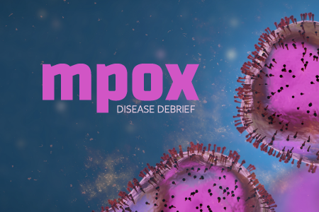

# MPOX

$~$

**Mpox** is an infectious disease caused by the monkeypox virus, which can spread between people through close physical contact. Although the disease has been recognised in parts of Africa for decades, the multinational outbreak associated with **clade IIb** in 2022 marked a significant expansion in its geographical distribution. Subsequent outbreaks involving clade I have raised new questions about transmission patterns and the populations affected.

In Canada and many other countries, the 2022 outbreak disproportionately affected gay, bisexual and other men who have sex with men. Recognising these patterns is important for targeted prevention, but public health responses must also account for transmission in other populations without reinforcing stigma. My research examines how emerging epidemiological evidence can inform mpox preparedness and response in Canada.

## Mpox Epidemiology and Public Health Risk

Reported differences in disease severity between mpox outbreaks do not necessarily reflect differences in the virus itself. The populations affected and their access to testing and treatment can influence which cases are detected and the outcomes recorded. Assessing emerging evidence on the transmission and clinical characteristics of mpox clades therefore requires careful interpretation, particularly when considering whether findings from one outbreak can inform public health responses in another setting.

Similar challenges arise when interpreting surveillance data. Declining numbers of reported mpox cases do not necessarily mean that transmission has ended, especially when testing access or reporting practices have changed. Continued case reporting can help public health authorities detect renewed transmission and changes in the populations affected. Examining these trends alongside emerging evidence on viral clades can inform public health risk assessment and decisions about surveillance as outbreak conditions evolve.

## Knowledge Translation for Public Health Practice

<p>
  Public health professionals need access to reliable information as evidence about mpox continues to develop. Changes in epidemiological understanding can have practical implications for assessing suspected infections and determining appropriate public health responses.
</p>

<p>
  Through my work at
  <a class="blog-source-link" href="https://nccid.ca" style="font-weight: 600 !important;"><span class="blog-link-text">National Collaborating Centre for Infectious Diseases</span><span class="blog-link-arrow" aria-hidden="true">&nbsp;↗</span></a>,
  I synthesised available evidence and public health guidance into a resource intended for Canadian practitioners. The aim was to make emerging research accessible and relevant to public health decisions, particularly where recommendations must account for uncertainty in the available evidence.
</p>

```{=html}

<p style="font-size: 1.5rem; font-weight: 600; color: #1B153E; margin-bottom: 1rem;">
  Featured Resource
</p>

<div style="display: flex; flex-wrap: wrap; gap: 2rem; align-items: flex-start; margin-top: 1.5rem;">

  <!-- Resource Image -->
  <div style="flex: 0 1 400px; max-width: 100%;">
    <a href="https://nccid.ca/debrief/mpox/"
       target="_blank"
       rel="noopener noreferrer">
      
    </a>
  </div>

  <!-- Resource Description -->
  <div style="flex: 1; min-width: 250px;">

    <!-- Title -->
    <h3 style="font-weight: 600; color: #1B153E; margin: 0 0 1rem 0; font-size: 1.05rem;">
      <a class="mpox-resource-link" href="https://nccid.ca/debrief/mpox/"
         target="_blank" rel="noopener noreferrer">Mpox Disease Debrief</a>
    </h3>

    <!-- Description -->
    <p>
      This debrief synthesises evidence on mpox epidemiology and emerging viral clades, providing Canadian public health professionals with guidance to support outbreak response and risk communication.
    </p>

    <!-- Resource Button -->
    <div style="margin-top: 1rem; margin-bottom: 1rem;">
      <a href="https://nccid.ca/debrief/mpox/"
         target="_blank"
         rel="noopener noreferrer"
         class="explore-button"
         style="
           flex: 0 0 auto;
           padding: 0.4rem 1rem !important;
           font-size: 0.9rem !important;
           width: auto !important;
           min-width: unset !important;
           white-space: nowrap !important;
           text-align: center;
           display: inline-block !important;
         ">
        View the Mpox Disease Debrief
      </a>
    </div>

    <!-- Citation -->
    <p style="font-size: 0.70rem;">
      <a class="mpox-resource-link" href="https://nccid.ca/debrief/mpox/"
         target="_blank" rel="noopener noreferrer"><span style="font-weight: 600;">Batac A.</span> Mpox [Internet]. Winnipeg (MB): National Collaborating Centre for Infectious Diseases; 2025 Feb. Available from: https://nccid.ca/debrief/mpox/</a>
    </p>

  </div>
</div>

```

## Contribution to Public Health

Differences between mpox outbreaks, coupled with uncertainty in surveillance data, can complicate decisions about public health responses. By synthesising emerging evidence and examining its implications for practice, my work aims to contribute to mpox preparedness and control by:

- Supporting public health risk assessment through evidence on emerging viral clades and changing transmission patterns.  
- Informing the interpretation of surveillance trends and decisions about continued case reporting. 
- Making emerging epidemiological and clinical evidence more accessible to public health professionals. 
- Supporting risk communication that reflects the circumstances of affected populations without reinforcing stigma. 

$~$

<small>
  This work was conducted in my capacity as a researcher with the
  <a class="blog-source-link" href="https://nccid.ca"
     target="_blank"
     rel="noopener noreferrer" style="font-weight: 600 !important;"><span class="blog-link-text">National Collaborating Centre for Infectious Diseases (NCCID)</span><span class="blog-link-arrow" aria-hidden="true">&nbsp;↗</span></a>.
  NCCID is funded by the Public Health Agency of Canada,
  and the views expressed herein may not necessarily represent
  the views of the Agency.
</small>

<style>
  h1, h2, h3, p {
    color: #1B153E;
  }

  /* Resource title and citation: underline on hover, without arrows. */
  a.mpox-resource-link,
  a.mpox-resource-link:visited {
    color: #1B153E;
    font-weight: inherit;
    text-decoration: none !important;
  }

  a.mpox-resource-link:hover,
  a.mpox-resource-link:focus-visible {
    color: #DE2221;
    text-decoration: underline !important;
    text-decoration-thickness: 1px;
    text-underline-offset: 0.18em;
  }

  /* Dotted source links with a separate external-link arrow */
  a.blog-source-link,
  a.blog-source-link:visited {
    color: #1B153E;
  }

  a.blog-source-link,
  a.blog-source-link:hover,
  a.blog-source-link:focus,
  a.blog-source-link:focus-visible {
    text-decoration: none !important;
  }

  a.blog-source-link .blog-link-text {
    text-decoration: underline dotted;
    text-decoration-thickness: 1px;
    text-underline-offset: 0.18em;
  }

  a.blog-source-link .blog-link-arrow {
    font-size: 0.8em;
    font-weight: 600;
    white-space: nowrap;
  }

  a.blog-source-link:hover,
  a.blog-source-link:focus-visible {
    color: #DE2221;
  }

  a.blog-source-link:focus-visible {
    outline: 2px solid #DE2221;
    outline-offset: 3px;
  }
</style>

$~$

$~$
