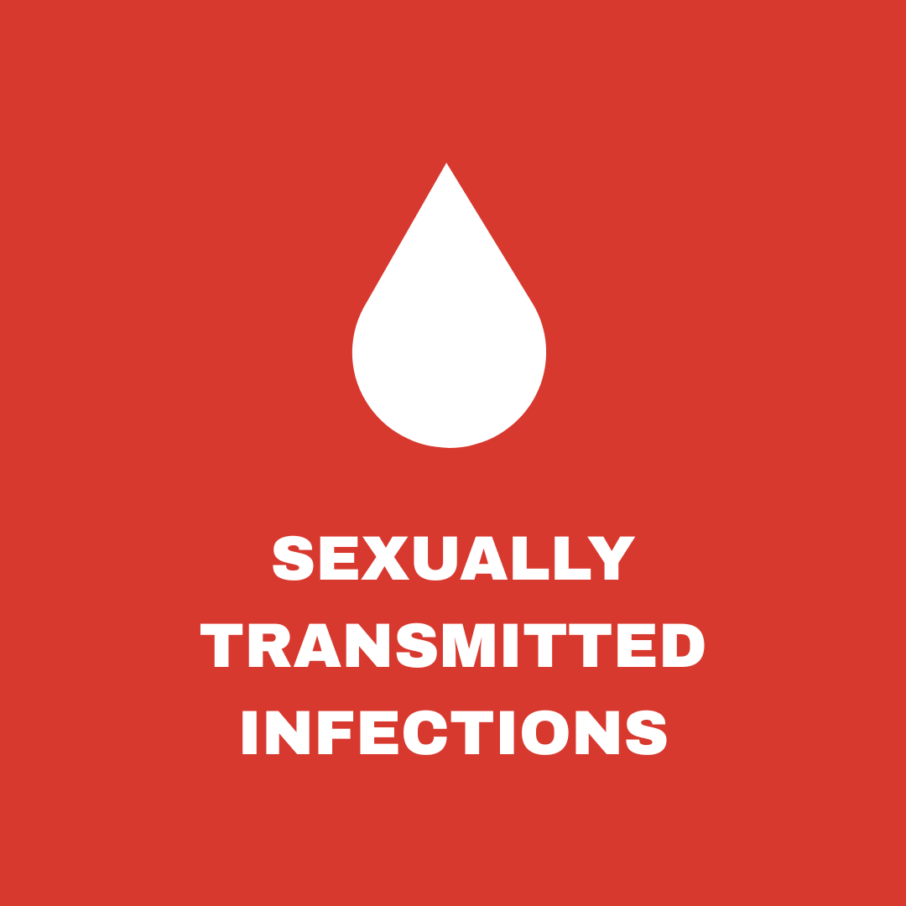
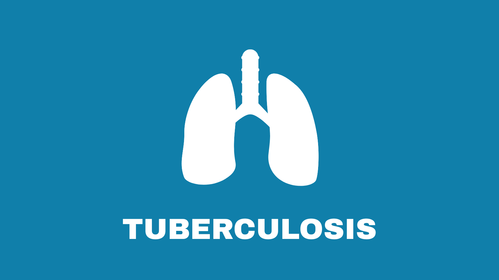
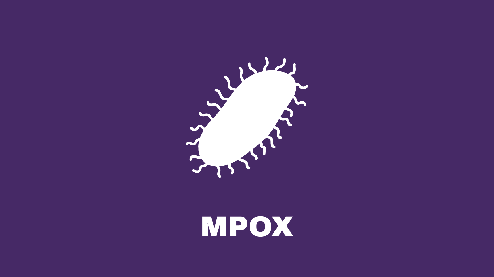
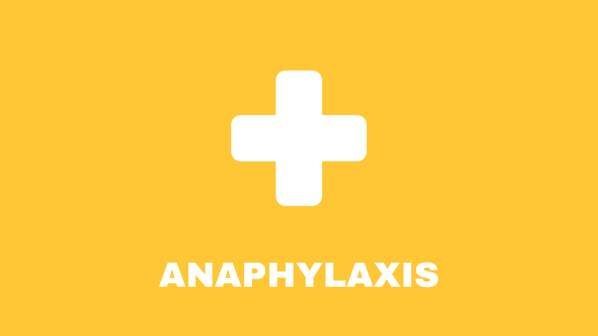

# RESEARCH {.research-page-title}

$~$

```{=html}
<div class="research-overview">

  <p class="research-intro">My research examines how people respond to health risks and what shapes their access to prevention and care. Much of my current work focuses on infectious disease prevention, particularly diagnostic access and the implementation of public health interventions. My research in allergy and clinical immunology examines the burden of allergic disease and barriers to accessing appropriate treatment.</p>

  <p class="research-intro">Mixed methods are central to my research, bringing together quantitative evidence and people's lived experiences. I draw on evidence synthesis to inform public health practice and use participatory research approaches to identify and learn from social innovations developed within communities.</p>

  <section class="research-section" aria-labelledby="current-research">
    <h2 id="current-research" class="research-section-title">CURRENT RESEARCH</h2>

    <div class="research-grid">

      <a class="research-card research-card-featured" href="sti.html" aria-labelledby="research-sti-title">
        <div class="research-card-image">
          
        </div>
        <div class="research-card-body">
          <span class="research-card-kicker">Featured research</span>
          <h3 id="research-sti-title">
            <span class="research-card-title">Sexually Transmitted Infections</span>
            <svg class="research-card-arrow" xmlns="http://www.w3.org/2000/svg" viewBox="0 0 24 24" width="24" height="24" fill="none" stroke="currentColor" stroke-width="2" stroke-linecap="round" stroke-linejoin="round" aria-hidden="true" focusable="false"><path d="M5 12h14m-6-6 6 6-6 6" /></svg>
          </h3>
          <p>Exploring the social and behavioural dimensions of STI testing and vaccination.</p>
        </div>
      </a>

      <a class="research-card" href="diagnostics.html" aria-labelledby="research-diagnostics-title">
        <div class="research-card-image">
          
        </div>
        <div class="research-card-body">
          <h3 id="research-diagnostics-title">
            <span class="research-card-title">Diagnostics</span>
            <svg class="research-card-arrow" xmlns="http://www.w3.org/2000/svg" viewBox="0 0 24 24" width="24" height="24" fill="none" stroke="currentColor" stroke-width="2" stroke-linecap="round" stroke-linejoin="round" aria-hidden="true" focusable="false"><path d="M5 12h14m-6-6 6 6-6 6" /></svg>
          </h3>
          <p>Understanding how diagnostic innovations can improve access to testing and care.</p>
        </div>
      </a>

      <a class="research-card" href="tuberculosis.html" aria-labelledby="research-tb-title">
        <div class="research-card-image">
          
        </div>
        <div class="research-card-body">
          <h3 id="research-tb-title">
            <span class="research-card-title">Tuberculosis</span>
            <svg class="research-card-arrow" xmlns="http://www.w3.org/2000/svg" viewBox="0 0 24 24" width="24" height="24" fill="none" stroke="currentColor" stroke-width="2" stroke-linecap="round" stroke-linejoin="round" aria-hidden="true" focusable="false"><path d="M5 12h14m-6-6 6 6-6 6" /></svg>
          </h3>
          <p>Examining how community-wide screening interventions are implemented to support tuberculosis prevention and control.</p>
        </div>
      </a>

      <a class="research-card" href="mpox.html" aria-labelledby="research-mpox-title">
        <div class="research-card-image">
          
        </div>
        <div class="research-card-body">
          <h3 id="research-mpox-title">
            <span class="research-card-title">Mpox</span>
            <svg class="research-card-arrow" xmlns="http://www.w3.org/2000/svg" viewBox="0 0 24 24" width="24" height="24" fill="none" stroke="currentColor" stroke-width="2" stroke-linecap="round" stroke-linejoin="round" aria-hidden="true" focusable="false"><path d="M5 12h14m-6-6 6 6-6 6" /></svg>
          </h3>
          <p>Interpreting emerging evidence to inform public health preparedness and outbreak response.</p>
        </div>
      </a>

      <a class="research-card" href="anaphylaxis.html" aria-labelledby="research-anaphylaxis-title">
        <div class="research-card-image">
          
        </div>
        <div class="research-card-body">
          <h3 id="research-anaphylaxis-title">
            <span class="research-card-title">Anaphylaxis</span>
            <svg class="research-card-arrow" xmlns="http://www.w3.org/2000/svg" viewBox="0 0 24 24" width="24" height="24" fill="none" stroke="currentColor" stroke-width="2" stroke-linecap="round" stroke-linejoin="round" aria-hidden="true" focusable="false"><path d="M5 12h14m-6-6 6 6-6 6" /></svg>
          </h3>
          <p>Understanding access to treatment and preparedness for anaphylaxis emergencies.</p>
        </div>
      </a>

    </div>
  </section>

  <section class="research-section" aria-labelledby="research-approaches">
    <h2 id="research-approaches" class="research-section-title">RESEARCH APPROACHES</h2>

    <div class="research-approaches-grid">
      <div class="research-approach">
        <h3>Mixed methods</h3>
        <p>Bringing together quantitative and qualitative evidence to understand how people engage with health services and how interventions work in practice.</p>
      </div>
      <div class="research-approach">
        <h3>Evidence synthesis</h3>
        <p>Synthesising existing research to inform prevention and care while identifying where further evidence is needed.</p>
      </div>
      <div class="research-approach">
        <h3>Participatory research</h3>
        <p>Drawing on community knowledge through crowdsourcing and co-creation to identify and learn from social innovations in health.</p>
      </div>
    </div>
  </section>

  <section class="research-section" aria-labelledby="research-background">
    <h2 id="research-background" class="research-section-title">RESEARCH BACKGROUND</h2>

    <details class="research-background-details">
      <summary>
        <span class="research-expand-icon" aria-hidden="true">+</span>
        <span class="research-summary-text">Read my research background</span>
      </summary>
      <div class="research-background-copy">
        <p>My research examines how people experience health problems and engage with the services available to them. My work began in allergy and clinical immunology and has expanded into infectious disease prevention, with a growing emphasis on how public health interventions are delivered in practice. Across these areas, I have used mixed methods and evidence synthesis to investigate questions that extend beyond clinical outcomes, particularly how people's experiences and the organisation of healthcare influence access to prevention and care.</p>

        <p>Much of my current research focuses on sexually transmitted infections (STIs) and the social and behavioural factors influencing engagement with prevention services. In China, I am evaluating the effectiveness and implementation of pay-it-forward strategies for gonorrhoea and chlamydia testing among men who have sex with men (MSM). I also examine how gonorrhoea vaccination is perceived and discussed within online communities as scientific evidence and vaccination policies evolve. Related work on syphilis self-testing has explored the potential of decentralised diagnostics to expand access while maintaining connections to appropriate clinical care.</p>

        <p>My recent work in infectious diseases has also addressed tuberculosis screening and mpox preparedness. In Nunavut, I contributed to research examining the planning and implementation of community-wide tuberculosis screening during an outbreak, with particular attention to community engagement and the practical challenges of delivering screening in a remote setting. My work on mpox involved assessing emerging epidemiological evidence and developing a knowledge translation resource to support Canadian public health professionals in interpreting changes in transmission and public health risk.</p>

        <p>My earlier research in allergy and clinical immunology drew on systematic and scoping reviews to examine the psychosocial burden of paediatric food allergy and how its financial impact on families is measured. I also investigated vaccine confidence among people managing allergy during the COVID-19 pandemic, using evidence synthesis and qualitative research to understand how concerns about allergic reactions influenced vaccination decisions. My work in maternal and child health included mixed methods research on infantile atopic dermatitis and maternal–infant bonding. Allergy remains an active part of my research through international work on access to anaphylaxis treatment and emergency care preparedness.</p>

        <p>Alongside these disease-focused projects, I use participatory research approaches to identify social innovations developed by communities in low-resource settings. Through crowdsourcing, I draw on community knowledge to bring attention to initiatives that might otherwise go unrecognised, while co-creation allows me to learn directly from the people behind them. This work complements my research on implementation by exploring how communities respond to health needs that existing services may not adequately address.</p>
      </div>
    </details>
  </section>

  <section class="research-section research-publications" aria-labelledby="research-publications">
    <h2 id="research-publications" class="research-section-title">PUBLICATIONS</h2>
    <p>Explore my peer-reviewed publications and other research outputs.</p>

    <a class="research-publications-link" href="publications.html">
      <span class="research-link-text">View Publications</span>
    </a>

    <p class="research-profiles-label">You can also find my work on:</p>
    <nav aria-label="Research profiles">
      <ul class="research-profile-links">
        <li><a href="https://scholar.google.com/citations?user=pUPl3Q8AAAAJ&amp;hl=en" target="_blank" rel="noopener noreferrer"><span class="research-link-text">Google Scholar</span></a></li>
        <li><a href="https://www.webofscience.com/wos/author/record/KUF-3735-2024" target="_blank" rel="noopener noreferrer"><span class="research-link-text">Web of Science</span></a></li>
        <li><a href="https://pubmed.ncbi.nlm.nih.gov/?term=Batac+ALR%5BAuthor%5D&amp;sort=date" target="_blank" rel="noopener noreferrer"><span class="research-link-text">PubMed</span></a></li>
        <li><a href="https://orcid.org/0000-0002-5712-5483" target="_blank" rel="noopener noreferrer"><span class="research-link-text">ORCID</span></a></li>
        <li><a href="https://www.researchgate.net/profile/Ayel-Luis-Batac" target="_blank" rel="noopener noreferrer"><span class="research-link-text">ResearchGate</span></a></li>
      </ul>
    </nav>
  </section>

</div>
```

$~$

<style>
  .research-page-title {
    color: #1B153E;
  }

  .research-overview {
    --research-navy: #1B153E;
    --research-red: #DE2221;
    color: var(--research-navy);
    font-family: inherit;
  }

  .research-overview,
  .research-overview * {
    box-sizing: border-box;
  }

  .research-overview p {
    color: var(--research-navy);
    line-height: 1.6;
  }

  .research-overview .research-intro {
    margin: 0;
    font-size: 1rem;
  }

  .research-overview .research-intro + .research-intro {
    margin-top: 1.25rem;
  }

  .research-section {
    margin-top: 3rem;
  }

  .research-overview .research-section-title {
    margin: 0 0 1.25rem;
    padding: 0;
    border: none;
    color: var(--research-navy);
    font-size: 1.4rem;
    font-weight: 600;
    line-height: 1.3;
  }

  .research-overview a,
  .research-overview a:hover,
  .research-overview a:focus-visible {
    text-decoration: none !important;
  }

  .research-overview a:focus-visible,
  .research-background-details summary:focus-visible {
    outline: 2px solid var(--research-red);
    outline-offset: 4px;
  }

  /* Research tiles */
  .research-grid {
    display: grid;
    grid-template-columns: repeat(2, minmax(0, 1fr));
    gap: 1.5rem;
  }

  .research-overview a.research-card {
    display: grid;
    grid-template-rows: auto 1fr;
    min-width: 0;
    overflow: hidden;
    border: 1px solid #eee;
    border-radius: 8px;
    background: #fff;
    color: var(--research-navy);
    box-shadow: 0 2px 6px rgba(0, 0, 0, 0.05);
    transition: transform 0.3s ease;
  }

  .research-overview a.research-card:hover,
  .research-overview a.research-card:focus-visible {
    transform: scale(1.02);
    color: var(--research-navy);
  }

  .research-card-image {
    position: relative;
    aspect-ratio: 16 / 9;
    min-width: 0;
    min-height: 0;
    overflow: hidden;
    background: rgba(27, 21, 62, 0.03);
  }

  /* Original image sizing, retained for the featured STI tile. */
  .research-overview .research-card-image img {
    display: block;
    width: 100%;
    height: 100%;
    object-fit: contain;
  }

  /* Keep the four redesigned images within their compact frames. */
  .research-overview .research-card:not(.research-card-featured) .research-card-image img {
    position: absolute;
    inset: 0;
    max-width: 100%;
    max-height: 100%;
    margin: 0;
    aspect-ratio: auto;
    object-position: center;
  }

  .research-card-body {
    display: flex;
    flex-direction: column;
    justify-content: center;
    min-width: 0;
    padding: 1.4rem;
  }

  .research-overview .research-card h3 {
    display: flex;
    justify-content: space-between;
    align-items: baseline;
    gap: 1rem;
    margin: 0 0 0.75rem;
    color: var(--research-navy);
    font-size: 1.1rem;
    font-weight: 600;
    line-height: 1.4;
  }

  .research-overview .research-card p {
    margin: 0;
    font-size: 0.95rem;
  }

  .research-card-arrow {
    display: block;
    width: 1.1em;
    height: 1.1em;
    flex-shrink: 0;
    color: var(--research-red);
    transition: transform 0.2s ease;
  }

  .research-card:hover .research-card-title,
  .research-card:focus-visible .research-card-title {
    text-decoration: underline;
    text-decoration-thickness: 2px;
    text-underline-offset: 0.2em;
  }

  .research-card:hover .research-card-arrow {
    transform: translateX(0.2rem);
  }

  .research-overview a.research-card-featured {
    grid-column: 1 / -1;
    grid-template-columns: minmax(0, 1.2fr) minmax(0, 1fr);
    grid-template-rows: auto;
  }

  .research-card-featured .research-card-image {
    order: 2;
    aspect-ratio: auto;
    min-height: auto;
  }

  .research-card-featured .research-card-body {
    order: 1;
    padding: 1.75rem;
  }

  .research-overview .research-card-featured h3 {
    font-size: 1.35rem;
  }

  .research-card-kicker {
    margin-bottom: 0.75rem;
    color: var(--research-red);
    font-size: 0.75rem;
    font-weight: 600;
    letter-spacing: 0.06em;
    text-transform: uppercase;
  }

  /* Research approaches */
  .research-approaches-grid {
    display: grid;
    grid-template-columns: repeat(3, minmax(0, 1fr));
    gap: 1.75rem;
  }

  .research-overview .research-approach h3 {
    margin: 0 0 0.75rem;
    color: var(--research-navy);
    font-size: 1rem;
    font-weight: 600;
    line-height: 1.4;
  }

  .research-overview .research-approach p {
    margin: 0;
    font-size: 0.95rem;
  }

  /* Expandable research background */
  .research-background-details summary {
    display: flex;
    align-items: center;
    gap: 0.65rem;
    width: fit-content;
    max-width: 100%;
    padding: 0.25rem 0;
    color: var(--research-navy);
    font-weight: 600;
    cursor: pointer;
    list-style: none;
  }

  .research-background-details summary::-webkit-details-marker {
    display: none;
  }

  .research-expand-icon {
    flex: 0 0 1.1rem;
    color: var(--research-red);
    font-size: 1.25rem;
    line-height: 1;
    text-align: center;
  }

  .research-background-details[open] .research-expand-icon {
    transform: rotate(45deg);
  }

  .research-background-details summary:hover .research-summary-text {
    text-decoration: underline;
    text-underline-offset: 0.2em;
  }

  .research-background-copy {
    margin-top: 1.25rem;
  }

  .research-background-copy p {
    margin: 0 0 1.25rem;
  }

  .research-background-copy p:last-child {
    margin-bottom: 0;
  }

  /* Match the research-platform button sizing on the publications page. */
  .research-overview .research-publications-link,
  .research-overview .research-profile-links a {
    display: inline-flex;
    align-items: center;
    justify-content: center;
    flex: 0 0 auto;
    gap: 0.4rem;
    width: auto;
    min-width: unset;
    max-width: 100%;
    padding: 0.4rem 1rem;
    border: none;
    border-radius: 8px;
    background: var(--research-navy);
    color: #fff;
    font-size: 0.9rem;
    font-weight: 600;
    line-height: inherit;
    white-space: nowrap;
    text-align: center;
    transition: background-color 0.2s ease;
  }

  .research-overview .research-publications-link:hover,
  .research-overview .research-publications-link:focus-visible,
  .research-overview .research-profile-links a:hover,
  .research-overview .research-profile-links a:focus-visible {
    background: var(--research-red);
    color: #fff;
  }

  .research-overview .research-profiles-label {
    margin: 1.5rem 0 0.65rem;
    font-size: 0.9rem;
  }

  .research-profile-links {
    display: flex;
    flex-wrap: wrap;
    gap: 0.65rem 0.75rem;
    margin: 0;
    padding: 0;
    list-style: none;
  }

  .research-profile-links li {
    margin: 0;
  }

  .research-publications-link:hover .research-link-text,
  .research-publications-link:focus-visible .research-link-text,
  .research-profile-links a:hover .research-link-text,
  .research-profile-links a:focus-visible .research-link-text {
    text-decoration: underline;
    text-decoration-thickness: auto;
    text-underline-offset: 3px;
  }

  @media (max-width: 640px) {
    .research-section {
      margin-top: 2.5rem;
    }

    .research-grid,
    .research-approaches-grid,
    .research-overview a.research-card-featured {
      grid-template-columns: minmax(0, 1fr);
    }

    .research-card-featured .research-card-image {
      order: 0;
      aspect-ratio: 16 / 9;
    }

    .research-card-featured .research-card-body {
      padding: 1.4rem;
    }
  }

  @media (prefers-reduced-motion: reduce) {
    .research-overview a.research-card,
    .research-card-arrow,
    .research-overview .research-publications-link,
    .research-overview .research-profile-links a {
      transition: none;
    }

    .research-overview a.research-card:hover,
    .research-overview a.research-card:focus-visible,
    .research-card:hover .research-card-arrow {
      transform: none;
    }
  }
</style>

$~$
