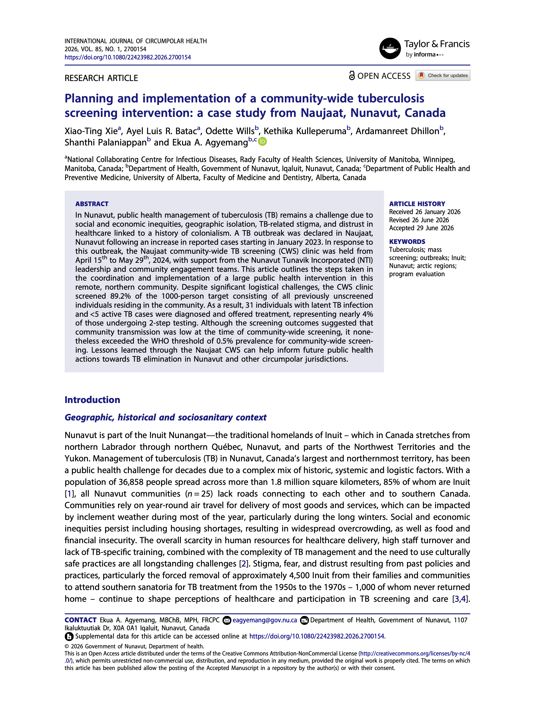

# TUBERCULOSIS

$~$

Early detection of **tuberculosis (TB)** is essential to preventing severe illness and reducing transmission. Yet access to TB screening remains uneven, particularly in remote and underserved communities where healthcare services may have limited capacity.

My research examines how TB screening interventions can be delivered within existing health systems while responding to the needs of the communities they serve. I am particularly interested in the practical demands of community-wide screening and how these interventions function alongside routine healthcare services.

## Community-Wide Screening for Tuberculosis

Routine approaches to detecting TB often depend on people seeking care when symptoms develop or being identified through contact tracing. During some outbreaks, these approaches may miss individuals with undetected TB, particularly when symptoms are absent or connections between cases are difficult to establish. **Community-wide screening** offers a more proactive approach by extending screening to a broader population. It can identify people who require further assessment for TB disease, while screening for TB infection may identify those who could benefit from preventive treatment once active disease has been excluded.

Community-wide screening may be particularly valuable when ongoing transmission suggests that routine testing and contact tracing alone are insufficient. However, delivering screening at this scale can place considerable demands on healthcare services. In remote settings, additional personnel and diagnostic resources may be needed while local facilities continue providing routine care.

## Community Engagement and Access to Screening

TB-related stigma and concerns about confidentiality can discourage people from participating in screening, even when services are available. Practical barriers may also differ between communities, particularly when the location or timing of screening activities makes participation difficult. Involving community members in planning can help public health teams identify these challenges and adapt how screening is delivered.

Local leaders and residents can influence how information about TB is communicated and how screening services are organised. Their involvement is particularly meaningful when communities have opportunities to shape decisions during planning, rather than being consulted only after an intervention has been designed.

## Beyond Screening: Implementation and Continuity of Care

People identified through community-wide screening may require further diagnostic assessment, while treatment for TB disease or infection may continue long after a temporary screening clinic closes. Clear referral pathways are essential to connect these individuals with existing TB services and ensure access to appropriate follow-up care. Without sufficient capacity to provide ongoing care, the benefits of expanded screening may be limited.

Screening participation and case detection figures provide only part of the evidence needed to evaluate an intervention. Examining how screening was organised and delivered can reveal challenges that may not be apparent from these outcomes alone. Understanding where difficulties arose can help public health teams identify practical improvements for future screening responses.

## Contribution to Public Health

Community-wide screening can create opportunities to identify tuberculosis earlier and reach people who might otherwise remain undiagnosed. When supported by appropriate healthcare services, these interventions have the potential to contribute to TB prevention and control by:

- Supporting earlier diagnosis and treatment of TB disease, with the potential to reduce further transmission.  
- Expanding opportunities for preventive treatment among people with TB infection who might otherwise remain unidentified.  
- Reducing inequities in access to TB screening among populations underserved by conventional healthcare services.  
- Strengthening public health preparedness by informing more effective and locally responsive approaches to future TB outbreaks.  

$~$

```{=html}
<p style="font-size: 1.5rem; font-weight: 600; color: #1B153E; margin-bottom: 1rem;">
  Featured Publication
</p>

<div style="display: flex; flex-wrap: wrap; gap: 2rem; align-items: flex-start; margin-top: 1.5rem;">

  <!-- Publication Image -->
  <div style="flex: 0 0 400px; max-width: 100%;">
    <a href="https://doi.org/10.1080/22423982.2026.2700154" target="_blank" rel="noopener noreferrer">
      
    </a>
  </div>

  <!-- Publication Description -->
  <div style="flex: 1; min-width: 250px;">

    <!-- Title -->
    <h3 style="font-weight: 600; color: #1B153E; margin: 0 0 1rem 0; font-size: 1.05rem;">
      <a href="https://doi.org/10.1080/22423982.2026.2700154"
         target="_blank"
         rel="noopener noreferrer"
         style="color: inherit; text-decoration: none; font-weight: inherit;"
         onmouseover="this.style.color='#DE2221'"
         onmouseout="this.style.color='#1B153E'">
        Planning and implementation of a community-wide tuberculosis screening intervention: a case study from Naujaat, Nunavut, Canada
      </a>
    </h3>

    <!-- Description -->
    <p>
      This study, published in the <i>International Journal of Circumpolar Health</i>, examines the planning and delivery of a community-wide TB screening clinic during an outbreak in Naujaat, Nunavut. The clinic reached 89.2% of its original screening target and identified individuals requiring treatment for TB infection or disease. Drawing on findings from an internal After Action Review, the article explores how community engagement and operational experience can inform future screening responses in remote northern settings.
    </p>

    <div style="margin-top: 1rem; margin-bottom: 1rem;">
      <a href="https://doi.org/10.1080/22423982.2026.2700154"
         target="_blank"
         rel="noopener noreferrer"
         class="explore-button"
         style="
           flex: 0 0 auto;
           padding: 0.4rem 1rem !important;
           font-size: 0.9rem !important;
           width: auto !important;
           min-width: unset !important;
           white-space: nowrap !important;
           text-align: center;
           display: inline-block !important;
         ">
        Read the article
      </a>
    </div>

    <!-- Citation -->
    <p style="font-size: 0.70rem;">
      <a href="https://doi.org/10.1080/22423982.2026.2700154" target="_blank" rel="noopener noreferrer" style="text-decoration: none; color: #1B153E;" onmouseover="this.style.color='#DE2221'" onmouseout="this.style.color='#1B153E'">
        Xie XT, <strong>Batac ALR</strong>, et al. Planning and implementation of a community-wide tuberculosis screening intervention: a case study from Naujaat, Nunavut, Canada. Int J Circumpolar Health. 2026 Dec;85(1):2700154. doi: 10.1080/22423982.2026.2700154.
      </a>
    </p>

  </div>
</div>
```

$~$

<small>
  This research is conducted in my capacity as a researcher at the
  <a href="https://nccid.ca" style="font-weight: 600 !important;">National Collaborating Centre for Infectious Diseases</a>,
  in collaboration with the
  <span style="font-weight: 600;">Government of Nunavut Department of Health</span>,
  the <span style="font-weight: 600;">Chief Public Health Officer of Nunavut</span>,
  and community partners involved in tuberculosis prevention and control in Nunavut.
</small>

<style>
  h1, h2, h3, p {
    color: #1B153E;
  }
</style>

$~$

$~$
