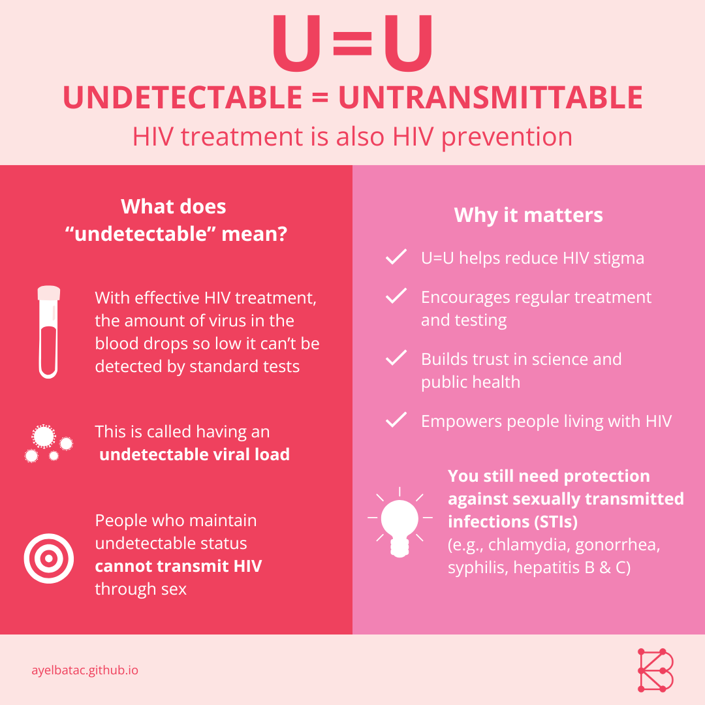

<style>
  h1, h2, h3, p {
    color: #1B153E;
  }
  a.study-button {
    background-color: #1B153E;
    color: white;
    padding: 0.6rem 1.2rem;
    border-radius: 6px;
    text-decoration: none;
    font-weight: bold;
    display: inline-block;
    transition: background-color 0.3s ease;
  }
  a.study-button:hover {
    background-color: #DE2221;
    color: white;
  }

  /* Dotted source links with a separate external-link arrow */
  a.blog-source-link,
  a.blog-source-link:visited {
    color: #1B153E;
  }

  a.blog-source-link,
  a.blog-source-link:hover,
  a.blog-source-link:focus,
  a.blog-source-link:focus-visible {
    text-decoration: none !important;
  }

  a.blog-source-link .blog-link-text {
    text-decoration: underline dotted;
    text-decoration-thickness: 1px;
    text-underline-offset: 0.18em;
  }

  a.blog-source-link .blog-link-arrow {
    font-size: 0.8em;
    font-weight: 600;
    white-space: nowrap;
  }

  a.blog-source-link:hover,
  a.blog-source-link:focus-visible {
    color: #DE2221;
  }

  a.blog-source-link:focus-visible {
    outline: 2px solid #DE2221;
    outline-offset: 3px;
  }

  /* Rounded infographic with a gentle hover effect */
  a.blog-infographic-trigger {
    display: block;
    width: fit-content;
    max-width: 100%;
    margin: 2rem auto;
    overflow: hidden;
    border-radius: 1rem;
    cursor: zoom-in;
    box-shadow: none;
    transition: transform 0.2s ease;
    text-decoration: none !important;
  }

  .blog-infographic-trigger img {
    display: block;
    max-width: 100%;
    height: auto;
    border-radius: inherit;
  }

  @media (hover: hover) and (pointer: fine) {
    a.blog-infographic-trigger:hover {
      transform: translateY(-2px) scale(1.01);
      box-shadow: none;
    }
  }

  a.blog-infographic-trigger:focus-visible {
    outline: 3px solid #DE2221;
    outline-offset: 5px;
  }

  /* The native modal sits above the site header. */
  .blog-infographic-dialog {
    position: fixed;
    inset: 0;
    box-sizing: border-box;
    width: 100%;
    max-width: none;
    height: 100vh;
    height: 100dvh;
    max-height: none;
    margin: 0;
    padding: 1rem;
    border: none;
    background: transparent;
    box-shadow: none;
    overflow: hidden;
  }

  .blog-infographic-dialog:not([open]) {
    display: none;
  }

  .blog-infographic-dialog[open] {
    display: flex;
    align-items: center;
    justify-content: center;
  }

  .blog-infographic-dialog::backdrop {
    background: rgba(27, 21, 62, 0.45);
    -webkit-backdrop-filter: blur(8px);
    backdrop-filter: blur(8px);
  }

  .blog-infographic-frame {
    position: relative;
    flex: none;
    width: max-content;
    border-radius: 1rem;
    background: transparent;
    box-shadow: none;
  }

  /* Keep the original dimensions, scaling down only to fit the screen. */
  .blog-infographic-frame img {
    display: block;
    width: auto;
    height: auto;
    max-width: calc(100vw - 2rem);
    max-height: calc(100vh - 2rem);
    max-height: calc(100dvh - 2rem);
    object-fit: contain;
    border-radius: inherit;
  }

  .blog-infographic-close-form {
    position: absolute;
    top: 0;
    right: 0;
    display: flex;
    align-items: flex-start;
    justify-content: flex-end;
    box-sizing: border-box;
    width: 6rem;
    height: 6rem;
    max-width: 100%;
    max-height: 100%;
    margin: 0;
    padding: 0.75rem;
  }

  .blog-infographic-close {
    display: flex;
    align-items: center;
    justify-content: center;
    width: 2.75rem;
    height: 2.75rem;
    padding: 0;
    border: none;
    border-radius: 0;
    background: transparent;
    color: #ffffff;
    font-family: inherit;
    font-size: 0.8rem;
    line-height: 1.2;
    cursor: pointer;
    box-shadow: none;
    opacity: 0;
    transition: opacity 0.15s ease, color 0.15s ease;
  }

  .blog-infographic-close svg {
    width: 1.75rem;
    height: 1.75rem;
  }

  .blog-infographic-close:hover,
  .blog-infographic-close:active {
    color: #bdbdbd;
  }

  .blog-infographic-close,
  .blog-infographic-close:hover,
  .blog-infographic-close:focus,
  .blog-infographic-close:focus-visible,
  .blog-infographic-close:active {
    outline: none;
    box-shadow: none;
  }

  /* Reveal only when the pointer enters the image's top-right corner. */
  .blog-infographic-close-form:hover .blog-infographic-close {
    opacity: 1;
  }

  html.blog-infographic-open,
  html.blog-infographic-open body {
    overflow: hidden;
  }

  html.blog-infographic-open {
    scrollbar-gutter: stable;
  }

  @media (prefers-reduced-motion: reduce) {
    a.blog-infographic-trigger,
    .blog-infographic-close {
      transition: none;
    }

    a.blog-infographic-trigger:hover {
      transform: none;
    }
  }
</style>

# U=U: What It Means and Why It Matters

May 23, 2025

$~$

One of the things I wish more people understood about HIV is just how much treatment has changed what it means to live with the virus.

Effective HIV treatment doesn't only help people stay healthy. When someone maintains an **undetectable viral load** through treatment, they **cannot transmit HIV** through sex.

This is known as **Undetectable = Untransmittable**, or **U=U**.

### What does U=U mean?

**Antiretroviral therapy (ART)** works by preventing HIV from making copies of itself. With effective treatment, the amount of HIV in someone's blood, known as their viral load, can fall to levels too low for a test to detect.

This is called having an **undetectable viral load**.

An undetectable viral load doesn't mean HIV has been cured. The virus remains in the body, and treatment needs to continue to keep it under control.

The evidence for U=U applies when a person's viral load stays <a class="blog-source-link" href="https://www.canada.ca/en/services/health/campaigns/hiv-aids.html"><span class="blog-link-text"><strong>below 200 copies of HIV per mL of blood</strong></span><span class="blog-link-arrow" aria-hidden="true">&nbsp;↗</span></a>. This prevents sexual transmission, even if a sensitive test detects a small amount of HIV.

Because viral suppression takes time to achieve, U=U doesn't apply immediately after someone starts treatment. Regular viral load testing helps confirm when suppression has been achieved and maintained.

### How do we know that U=U works?

Three major studies have helped establish what we know about HIV treatment and sexual transmission.

#### 🧪 **HPTN 052 (2011 and 2016)**
The HPTN 052 study followed more than **1,700 couples** where one partner was living with HIV. Nearly all (97%) were heterosexual. Researchers compared starting HIV treatment early with delaying it.

The <a class="blog-source-link" href="https://doi.org/10.1056/NEJMoa1105243"><span class="blog-link-text">initial findings published in 2011</span><span class="blog-link-arrow" aria-hidden="true">&nbsp;↗</span></a> showed that starting treatment earlier reduced the risk of HIV transmission to the partner who wasn't living with HIV by 96%.

The <a class="blog-source-link" href="https://doi.org/10.1056/NEJMoa1600693"><span class="blog-link-text">final results published in 2016</span><span class="blog-link-arrow" aria-hidden="true">&nbsp;↗</span></a> confirmed the benefits of earlier treatment over longer follow-up. Importantly, **no HIV transmissions** linked between partners occurred during stable viral suppression.

#### 🧪 **PARTNER (2016)**
The <a class="blog-source-link" href="https://doi.org/10.1001/jama.2016.5148"><span class="blog-link-text">PARTNER study</span><span class="blog-link-arrow" aria-hidden="true">&nbsp;↗</span></a> examined HIV transmission among **heterosexual and gay couples** where one partner was living with HIV and taking effective treatment.

The analysis included **888 couples** who reported having sex without condoms while the partner living with HIV maintained viral suppression.

There were **no HIV transmissions** linked between partners during the eligible follow-up period.

#### 🧪 **PARTNER2 Study (2019)**
The <a class="blog-source-link" href="https://doi.org/10.1016/S0140-6736(19)30418-0"><span class="blog-link-text">PARTNER2 study</span><span class="blog-link-arrow" aria-hidden="true">&nbsp;↗</span></a> provided further evidence among **gay male couples**.

During the study, participants reported approximately **76,000 acts of condomless anal sex** while the partner living with HIV maintained viral suppression.

Again, researchers found **no HIV transmissions** linked between partners. Some people who were HIV-negative at the start of the PARTNER studies acquired HIV during follow-up, but genetic testing showed that these infections weren't linked to their study partners.

### What does this mean for people living with HIV?

For a person living with HIV, knowing that effective treatment prevents sexual transmission can change how they think about relationships and intimacy. It can also help address fears that may have been shaped by outdated information about HIV.

Knowing about U=U doesn't mean that stigma disappears. People's experiences of HIV are shaped by more than their viral load, and no one should have to demonstrate that they're undetectable to be treated with dignity.

### Access to treatment matters

Achieving and maintaining an undetectable viral load depends on having reliable access to HIV treatment. People also need ongoing care to make sure their treatment continues to work.

That isn't always straightforward. The cost of treatment can be a barrier in some settings, while others may struggle to attend appointments or access regular viral load testing. Stigma can make seeking HIV care difficult too.

### What about other STIs?

U=U refers specifically to the sexual transmission of HIV. It doesn't prevent other STIs, including gonorrhoea, chlamydia, and syphilis.

Condoms remain an effective way to reduce the risk of many STIs. **Pre-exposure prophylaxis (PrEP)** helps people without HIV prevent infection, while vaccines can prevent certain infections, including HPV (human papillomavirus) and hepatitis B.

### U=U at a glance

I made this infographic as a quick summary of what U=U means.

```{=html}
<a href="u_equals_u.png"
   class="blog-infographic-trigger"
   id="uu-infographic-trigger"
   aria-label="Open enlarged U=U infographic"
   aria-haspopup="dialog"
   aria-controls="uu-infographic-lightbox">
  
</a>

<dialog class="blog-infographic-dialog"
        id="uu-infographic-lightbox"
        aria-label="Enlarged U=U infographic">
  <div class="blog-infographic-frame">
    
    <form method="dialog" class="blog-infographic-close-form">
      <button type="submit" class="blog-infographic-close"
              aria-label="Close enlarged infographic" title="Close">
        <svg viewBox="0 0 24 24" fill="none" stroke="currentColor"
             stroke-width="2" stroke-linecap="round" aria-hidden="true"
             focusable="false">
          <path d="M6 6l12 12M18 6 6 18"/>
        </svg>
      </button>
    </form>
  </div>
</dialog>
```

For me, U=U is one of those scientific findings that should be part of an ordinary conversation about HIV care. People shouldn't have to come across this information by chance.

–Ayel

$~$

```{=html}
<script>
(() => {
  function initInfographicLightbox() {
    const trigger = document.getElementById('uu-infographic-trigger');
    const dialog = document.getElementById('uu-infographic-lightbox');
    if (!trigger || !dialog || typeof dialog.showModal !== 'function') return;

    const root = document.documentElement;
    let startedOutsideImage = false;

    trigger.addEventListener('click', event => {
      if (event.button !== 0 || event.metaKey || event.ctrlKey || event.shiftKey || event.altKey) return;
      try {
        dialog.showModal();
      } catch {
        return; // Keep the ordinary image link if the modal cannot open.
      }
      event.preventDefault();
      root.classList.add('blog-infographic-open');
    });

    dialog.addEventListener('pointerdown', event => {
      startedOutsideImage = event.target === dialog;
    });

    dialog.addEventListener('click', event => {
      if (event.target === dialog && startedOutsideImage) dialog.close();
      startedOutsideImage = false;
    });

    // The close button, Escape and backdrop click all use the same cleanup.
    dialog.addEventListener('close', () => {
      root.classList.remove('blog-infographic-open');
      trigger.focus({ preventScroll: true });
    });
  }

  if (document.readyState === 'loading') {
    document.addEventListener('DOMContentLoaded', initInfographicLightbox, { once: true });
  } else {
    initInfographicLightbox();
  }
})();
</script>
```
